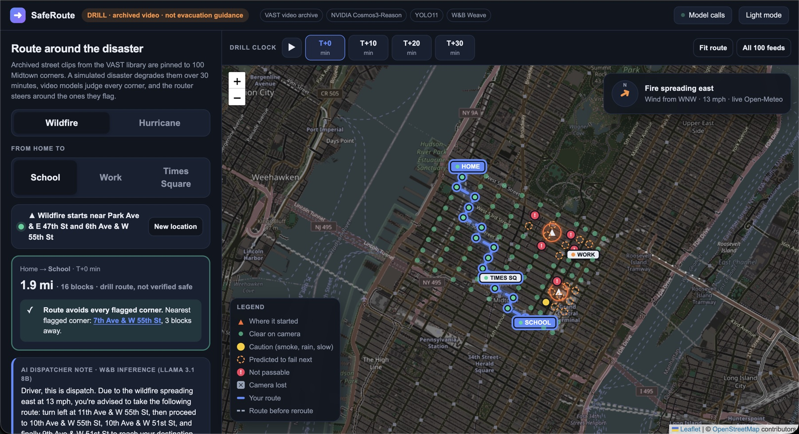
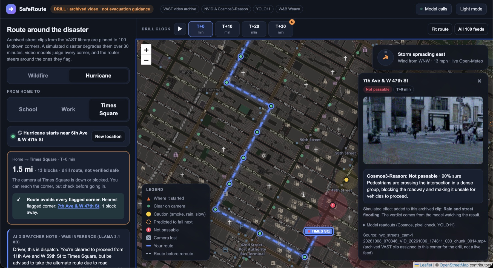
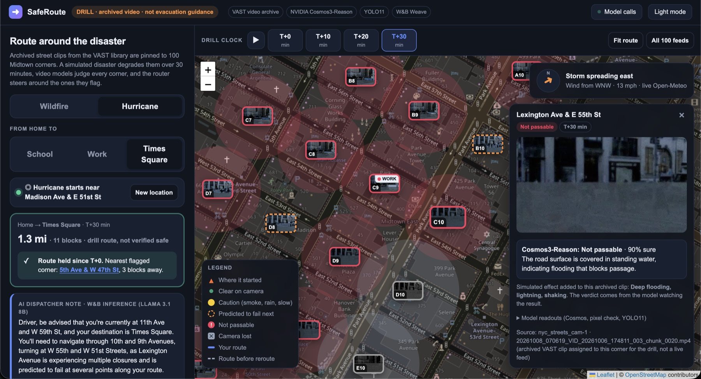
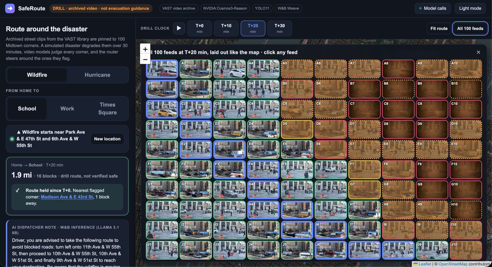
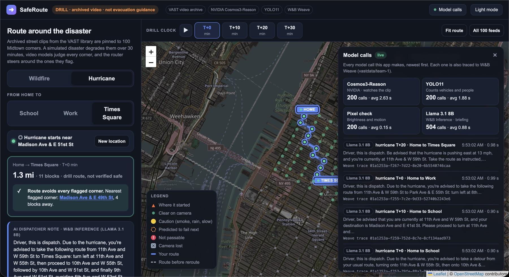

# SafeRoute

AI evacuation routing from real street cameras, built for the VAST Builders Challenge.

The fastest road isn't always the safest one. An empty road could mean no traffic, or it could
mean smoke, flooding or a blockage. SafeRoute gives navigation eyes: during a simulated wildfire
or hurricane, video models watch 100 real NYC street-camera clips, decide which Midtown
intersections are still usable, predict which ones fail next, and route a driver from Home to
School, Work or Times Square around the danger.

This is an **evacuation drill on archived footage**. It is not a real emergency system and does
not use live cameras or GPS.

## Hackathon

- **Event:** https://luma.com/vastnyc
- **App:** https://team-1-app.thecosmoslabs.com/app/
- **Hackathon helper scripts and documentation:** https://github.com/vast-data/vast-builders-challenge#vast-builders-challenge-video-agents
- **Video demo:** https://drive.google.com/drive/u/0/folders/1wlUDTBfK_u7htX3B_dBzQlylpunRDs8H
- **Hackathon submission:** https://tokensand.com/p/safe-route?mode=developer

## Screenshots



*A simulated wildfire at T+0. The blue line is the route from Home to School; red corners are not
passable and dashed orange corners are predicted to fail next.*

| | |
|---|---|
|  |  |
| *Click a corner to see its clip and the Cosmos3-Reason verdict.* | *Hurricane at T+30: deep flooding, and most of the area is not passable.* |
|  |  |
| *All 100 feeds at T+20 of a wildfire, laid out like the map.* | *Every model call, with timings and W&B Weave trace ids.* |

## What it does

- **Sees each intersection.** NVIDIA Cosmos3-Reason watches every clip and reports whether the
  road is passable, the visibility, the hazards and a one-sentence reason. YOLO11 counts
  vehicles and people, and a pixel check catches dead cameras.
- **Simulates the disaster on real footage.** Wildfire adds orange smoke haze; hurricane adds
  darkening, rain, street flooding and lightning. Both end in camera failure.
- **Routes over time.** The disaster spreads downwind using live Open-Meteo wind over T+0, T+10,
  T+20 and T+30 minutes, so leaving now and leaving in ten minutes can give different routes.
- **Predicts, then checks itself.** Corners downwind of a hit are predicted to fail next, and
  each prediction is scored at the next step against what the models saw.
- **Is not hard-coded.** Picking a new location starts the disaster somewhere else, and the
  spread and the routes change with it.
- **Briefs the driver.** W&B Inference (Llama 3.1 8B) writes a dispatcher briefing for every
  route, and every model call is traced to W&B Weave.

## Built with

| Technology | Role |
|------------|------|
| Cursor | Coding |
| VAST Data | Video archive and search: the 100 NYC street-camera clips |
| NVIDIA Cosmos3-Reason | Video inference: passable, visibility, traffic, hazards |
| YOLO11 | Vehicle and people counts |
| Weights & Biases | Inference (Llama 3.1 8B briefings) and Weave observability |
| Open-Meteo | Live wind for the disaster spread |

## Repository

| Path | Contents |
|------|----------|
| [tools/saferoute/](tools/saferoute/) | The app: Flask backend, single-page Leaflet UI and tests |
| [tools/saferoute/README.md](tools/saferoute/README.md) | How it works in detail, environment variables, running and deployment |
| [docs/video_demo_script.md](docs/video_demo_script.md) | Production script for the demo video |
| [docs/screenshots/](docs/screenshots/) | Screenshots of the deployed app |

## Quick start

The app needs access to the VAST video search API, the GPU model endpoints and (optionally) W&B.
The variable names are listed in [tools/saferoute/README.md](tools/saferoute/README.md); never
commit their values.

```bash
cd tools/saferoute
pip install -r requirements.txt
python main.py            # serves at http://localhost:8080/
python3 test_router.py    # routing and prediction tests
```

The first start analyzes 700 clips, which takes about 7 minutes.

## License

[MIT](LICENSE). Leaflet is vendored in `tools/saferoute/` under its own BSD 2-Clause license.
