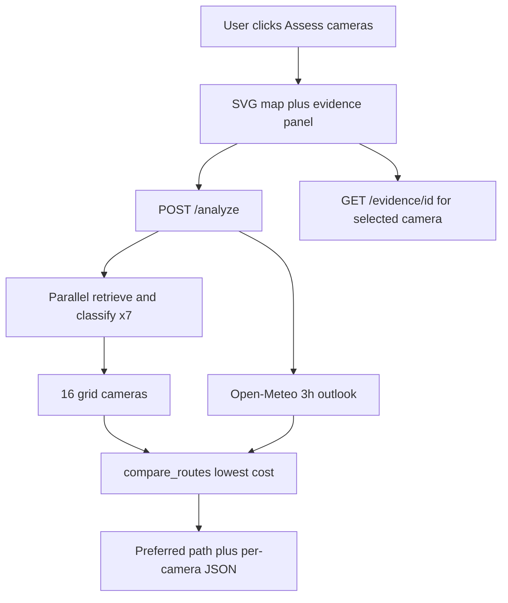

<!-- d3fbac76-4524-470d-88c8-eabba34c8b0b -->
---
todos:
  - id: "preflight"
    content: "Phase A: Verify team identity, VSS search/playback (i24), W&B inference+Weave, kubectl namespace access"
    status: pending
  - id: "scaffold"
    content: "Phase B: Create tools/saferoute/ layout (Flask, requirements, README) under ConfigMap size limit"
    status: pending
  - id: "vast-module"
    content: "Phase C1-C2: Implement VSS login/search/metadata/detections + evidence proxy + sanitized Evidence model"
    status: pending
  - id: "wandb-weave"
    content: "Phase C3/C5: Discover W&B model; classify with Pydantic fail-closed; weave.op on retrieve/classify/compare"
    status: pending
  - id: "router-ui"
    content: "Phase C4/D/E: 4x4 grid, 16 cameras, hurricane/wildfire drill, offline means damaged, predict next cell, safe route"
    status: pending
  - id: "deploy-k8s"
    content: "Phase F: ConfigMap + Secret (VSS+W&B) + Deployment/Service/Ingress /app; verify workshop App + health"
    status: pending
  - id: "tests-demo"
    content: "Phase G: Unit tests for routing honesty; acceptance checklist; README; demo recording notes"
    status: pending
isProject: false
---
# SafeRoute MVP — cursor_plan_v1

**Product shape (pivot):** A **disaster-routing drill** on a **4×4 grid (16 intersections, one camera each)**. The user picks **Hurricane** or **Wildfire**. Each camera feed says whether that corner is usable. A camera that does not answer is treated as **already hit**. The app then marks the **next** corner the event is likely to reach and draws a **route to shelter** that avoids both. This is a labeled drill, not live evacuation guidance. Deployed at team Ingress `/app`.

**Source of truth:** the original hackathon brief plus repo skills (still no live GPS vendor APIs).  
**Deliverable after approval:** implement exactly this plan; persist as `cursor_plan_v1.md` in the repo root if you want it checked in.  
**Hard constraint:** workshop VM / team namespace only. No secrets in repo, UI, or Weave traces.

---

## 0. Locked product decisions (no open options)

| Decision | Choice | Why |
| --- | --- | --- |
| App framework | **Flask** (one process) | Smallest HTML+JSON surface; fits ConfigMap + `python:3.12-slim` |
| Layout | `tools/saferoute/` | Matches deploy-app-no-registry convention |
| K8s name prefix | `saferoute` | DNS-1123; distinct from VSS stack |
| Routing engine | **Plain Python graph** on a **simulated neighborhood map** (no OSMnx/OSRM/Google) | Real navigation UX; fake geography labeled as simulation |
| Map UX | **4×4 SVG grid**, **16 intersections**, **1 camera each**. Home at A1, Shelter at D4 | Big enough to show spread and a way around it |
| Playback | **Same-origin proxy** `GET /evidence/<id>` | Avoids putting VSS JWT in browser state |
| W&B model | **Discover at runtime** via `GET https://api.inference.wandb.ai/v1/models`; prefer first available of `meta-llama/Llama-3.1-8B-Instruct`, then `microsoft/Phi-4-mini-instruct`, then first listed chat model | Doc forbids hardcoding unverified names |
| Inference API | OpenAI-compatible client → `https://api.inference.wandb.ai/v1` | Official W&B Inference pattern |
| Scenario switch | **Hurricane** or **Wildfire**, one active at a time | Same grid, different spread direction and labels |
| Camera verdict | From the feed: **open**, **do not use**, or **camera dark** | Dark means the drill treats that corner as already hit |
| Prediction | Mark the **next grid neighbor** downwind / along the storm track | Deterministic spread, one step (two if wind is strong) |
| Safe route | Shortest path **A1 → D4** that avoids **do-not-use** and **predicted-next** cells | If none exists, say so and show the least-bad path that still avoids confirmed hits |
| Weather | Open-Meteo wind and rain at **40.758, -73.985** sets spread direction and whether the storm looks active | One district pin, not 16 climates |
| Camera count | **16** | 4×4 is the drill; every cell has a camera |
| Honesty | Archive has **no wildfire or hurricane video** (checked). Feeds are real traffic/street clips. Disaster meaning is a **labeled drill** | Fog, blockage, and dark cameras are the signals we actually have |
| Out of scope | Live HLS, phone GPS, Google Maps, a trained fire model, wildlife/animal markers, claiming this is real evacuation guidance | Drill only. Bears, deer, dogs, and cats stay off the map |
| How we build | **One Flask app, one pass, vertical slices.** No separate frontend project or second service | The demo is one page. Splitting UI and API burns the time we need to deploy |

---

## 1. Input data (what the app consumes)

SafeRoute does **not** bring its own video dataset. All real footage comes from the **team’s already-ingested VSS index** on the workshop stack.

### 1.1 Primary evidence source (real)

| What | Detail |
| --- | --- |
| Store | Team VSS / VastDB `vss-collection` behind `$INGRESS_URL` |
| How obtained | `POST /api/v1/search` after JWT login — **not** local files, **not** internet HLS |
| Preferred corpus | **I-24 Nashville** traffic: `metadata_filters.camera_id = "i24_cam-1"` |
| Fallback corpus | PIE driving `pie_cam-3`, or drop invalid filter after `list-metadata` |
| Default queries (in order) | `"dense traffic on the highway"` → `"vehicle stopped in traffic"` → `"traffic congestion"` |
| One hit used | Top usable `results[]` / `chunk_results[]` row with `source` + Cosmos `reasoning_content` |
| Sidecars | Cosmos caption (required for MVP); YOLO via `GET /videos/detections` if present (404 OK) |
| Playback | Same segment `source` URI streamed via backend proxy |

**We do not upload new internet video for the MVP** (licensing warning in the challenge README). Re-ingest of an existing indexed chunk is only an emergency if search is empty but Explore shows clips — not the default path.

### 1.2 What the user actually types / clicks

| Input | MVP behavior |
| --- | --- |
| **Search & Analyze** | No required form fields. App runs the default query + `i24_cam-1` filter server-side. |
| Optional later | Hidden/advanced `query` + `camera_id` in `POST /analyze` body only if preflight shows defaults fail — not a full search UI. |
| **DEMO TEST: injected congestion** | Synthetic **routing** input only. Does **not** invent video evidence. Real clip + real W&B observation still shown separately when demo inject is used for the router. |

### 1.3 What is fed into W&B (text evidence, not pixels)

The serverless LLM receives a structured text bundle built from the search hit:

- Cosmos `reasoning_content` (caption)
- Optional YOLO class counts / labels
- Camera id, similarity, segment timing if present
- Explicit instruction: classify road state only from this text; do not invent hazards or NYC geography

### 1.4 What is *not* input data today

- NYC 511 / live camera HLS
- User-uploaded `.mp4` from laptop (out of MVP; would use `ingest/upload-video` only if organizers approve and archive search fails)
- City graph / OSM / Google Maps geometry
- **Any GPS feed** (device location, GNSS, map matching, ETA APIs)
- Hand-labeled congestion ground truth for training
- Raw GPU NIM calls (Cosmos/YOLO already ran at ingest)

### 1.4b Disaster grid: 16 cameras, hurricane or wildfire

The driver starts at **Home (A1)** and needs **Shelter (D4)**. The town is a 4×4 grid. Every cell is an intersection with exactly one camera.

```text
        1          2          3          4
A   Home/A1      A2         A3         A4
B      B1         B2         B3         B4
C      C1         C2         C3         C4
D      D1         D2         D3      Shelter/D4
```

Rows A–D, columns 1–4. Neighbors share an edge (up, down, left, right).

**What each camera can say**

| Feed result | Cell status | Route rule |
| --- | --- | --- |
| Clip plays and W&B says the road looks usable (`normal`, confidence ≥ 0.75) | **Open** | May use this intersection |
| Clip plays and the caption/W&B shows blockage, stopped traffic, very poor visibility, or `possible_obstruction` | **Do not use** | Drop this intersection from safe routes |
| Search fails, times out, or there is no playable clip | **Camera dark** | Drill rule: treat as already hit by the hurricane or fire. Do not use |

**Predict the next intersection.** Open-Meteo wind at the district pin sets direction. If weather is down, wildfire defaults east and hurricane defaults north.

- **Wildfire:** every Do-not-use or Camera-dark cell marks the neighbor **downwind** as **Predicted next**. If wind speed ≥ 25 mph, also mark the cell beyond that (two steps).
- **Hurricane:** same idea along the storm track (downwind). Rain or high wind on the outlook makes the drill banner say the storm is active. Spread is still one step, or two if wind ≥ 25 mph.

Predicted-next cells are avoided even if their own camera still looks open. The UI says why: “B2 is dark, wind is east, so B3 may go next.”

**Safe route.** Grid shortest path from A1 to D4 that does not step on Do-not-use, Camera-dark, or Predicted-next cells. If no such path exists, show **No clear route** and a fallback path that still avoids confirmed hits, with a warning. Never call a route verified-safe.

**Two buttons**

1. **Read cameras** — 16 parallel VAST lookups (8s timeout each) and W&B on clips that return. Timeouts become Camera dark.
2. **Run disaster drill** — labeled simulation so the story always appears. Sets **A3, B2, and C3** to Camera dark. Pins a foggy neighborhood clip on **B3** and a stopped/blocking clip on **C2** as Do-not-use. A2 and B1 stay open so Home is not boxed in. Other cells keep real open clips. Banner: `DRILL — DARK CAMERAS ARE ASSUMED HIT. THIS IS NOT A LIVE DISASTER.`

Working cells rotate distinct archive clips we already found (I-24 flow, NYC intersection, bike lane, SF street, PIE queue, neighborhood fog). One clip is never copied onto two cells. The archive does not contain real wildfire or hurricane video; the drill says that on screen.

### 1.4c What the user sees

| Layer | Meaning |
| --- | --- |
| Scenario toggle | Hurricane or wildfire. Changes the story and the spread direction. |
| 16 cameras | Every corner has a feed or a dark camera. |
| Do not use | The picture says this corner is a bad place to drive through. |
| Camera dark | No picture. The drill assumes the disaster already took that camera out. |
| Predicted next | The neighbor the event is heading toward. |
| Route to shelter | A path from Home to Shelter that stays off those cells. |
| Weather | Live wind and rain tell which way the event moves. |

### 1.4d Weather’s only job

Open-Meteo, no key, point **40.758, -73.985**. Read wind direction, wind speed, precipitation, and weather code. Wind picks the neighbor that gets the “next” mark. If the call fails, use the scenario default (wildfire east, hurricane north) and show weather unavailable. W&B still only reads the camera caption. It does not invent a fire.

### 1.5 Honesty

The index was searched for wildfire, hurricane, flood, and smoke. Hits are ordinary streets, mostly fog or traffic. The app must say **archived street video + disaster drill**. A dark camera is an assumption for the drill, not proof of a real fire or storm. Do not tell the user a road is safe in the real world.

### 1.6 Preflight obligation for data

Before coding the UI, run VSS UI / skill search and record (sanitized): whether a congestion-like caption exists, which `camera_id` worked, and one example `source` path without tokens. That record drives default query strings baked into the app.

### 1.7 Live archive findings (team-1, inspected 2026-10-09)

Index is healthy: **~3537 indexed clips / 612 parent videos**. Cameras with traffic-relevant volume include `pie_cam-3` (1080), `nyc_bike_gopro-1`, `nyc_streets_cam-*`, `i24_cam-1` (180), SF street cams.

**Important honesty finding:** I-24 (`i24_cam-1`) search hits for “dense traffic…” almost always have Cosmos captions that **deny congestion** (“vehicles moving steadily… no signs of congestion”). So I-24 is excellent for a **real normal-traffic** path, but **not** a reliable auto route-flip without DEMO TEST.

**Recommended input videos / queries for the demo**

| Priority | Role in demo | How to retrieve | Example segment filename (tail) | Why |
| --- | --- | --- | --- | --- |
| **1 — Best “interesting road” evidence** | Likely `congested` / `possible_obstruction` from W&B | query `"dense traffic cars"` + `camera_id=pie_cam-3` | `20261001_071328_set06_video_chunk_0007_segment_004_of_006.mp4` (seg ~15–20s, Toronto) | Caption: SUV stopped ahead with brake lights; box truck partially blocking lane. YOLO: car/truck/bus. |
| **1b — Alternate obstruction-ish** | Same | same query / `pie_cam-3` | `…chunk_0007_segment_002…`, `…chunk_0008_segment_003…`, `…chunk_0006_segment_005…` | Similar stopped-ahead / slow dump-truck captions. |
| **2 — Busy urban + emergency presence** | May classify congested/investigate | `"busy intersection congestion"` + `nyc_streets_cam-2` | `20261008_072246_IMG_0509_chunk_0028_segment_001_of_006.mp4` | Busy intersection; stopped SUV; fire truck visible. Rich YOLO (person/car/truck/bike). |
| **2b — NYC van blocking** | Obstruction / investigate | same camera family | `20261008_071923_IMG_0509_chunk_0020_segment_002_of_006.mp4` | White van stopped mid-road partially blocking flow. |
| **3 — Honest normal highway** | Expect W&B `normal`; route stays A unless DEMO TEST | `"dense traffic on the highway"` + `i24_cam-1` | `20261001_055340_scene1_p1c1_chunk_0002_segment_006_of_006.mp4` (seg ~25–30s, Nashville) | Strong visual highway traffic but caption explicitly says no congestion. Perfect for fail-closed honesty. |

**Default retrieval:** one search per row in §1.4b, in parallel. If a camera’s search is empty, that intersection stays `unknown` / investigate and unpenalized. Do not reuse another intersection’s clip.

---

## 2. End-state architecture



**Sponsor proof mapping**

- **VAST:** real search hit + playable `source` + Cosmos `reasoning_content`
- **NVIDIA/CoreWeave:** display Cosmos caption + YOLO classes when present (already indexed; do not call GPU NIMs directly)
- **W&B:** real inference JSON + Weave trace of retrieve → classify → route
- **K8s:** ConfigMap+Secret+Deployment+Service+Ingress `/app` → workshop **App** button

---

## 3. Phase A — Preflight (do before any app code)

Stop conditions: each check must pass or have an explicit workaround noted in the demo README.

### A1. Team identity (names only; never print secrets)

```bash
# Variable NAMES only
env | cut -d= -f1 | sort | grep -E 'USERNAME|INGRESS|WANDB|KUBE|PIPELINE'

# Resolve team from config (parse; do not echo PASSWORD/API keys)
mapfile -t TEAM_CONFIGS < <(find /config -maxdepth 1 -type f -name '*.config' | sort)
# expect exactly one → USERNAME, INGRESS_URL
NS="$USERNAME"
export KUBECONFIG=/config/${NS}-k8s.yaml
TEAM_N="${USERNAME#team-}"
APP_HOST="video-lab-team-${TEAM_N}.cosmos.vastdata.com"
```

Confirm: `kubectl cluster-info`, `kubectl -n "$NS" get pods` (VSS stack healthy per [deployment/health](.cursor/skills/deployment/health/SKILL.md)).

### A2. VSS search + playback (skills: login, search, videos)

1. Login → JWT (cache in memory only).
2. Search:

```json
{
  "query": "dense traffic on the highway",
  "top_k": 5,
  "llm_top_n": 1,
  "min_similarity": 0.3,
  "metadata_filters": {"camera_id": "i24_cam-1"}
}
```

Fallback queries if weak/empty: `"vehicle stopped in traffic"`, `"traffic congestion"`. If filter yields nothing → [list-metadata](.cursor/skills/retrieval/list-metadata/SKILL.md) for valid `camera_id` values; retry without invalid filter; try `pie_cam-3`.

3. From first usable hit, capture: `source`, `reasoning_content`, similarity, timing fields present in the real payload (normalize after inspecting one live response — do not invent schema).
4. Optional: `GET /videos/detections?source=...` — 404 → `"No detections available"`.
5. Confirm stream works with `?token=` (server-side only later).

**Record for demo (sanitized):** camera_id, truncated source path (no JWT), whether congestion-like caption exists.

### A3. W&B inference + Weave egress

From VM shell (values already in env; inject later into K8s Secret):

1. List models with team API key against `https://api.inference.wandb.ai/v1/models`.
2. One chat completion that returns JSON matching the observation schema.
3. `weave.init(f"{WANDB_TEAM}/{WANDB_PROJECT}")` + one `@weave.op` no-op / tiny call; open Weave UI and confirm a run appears.
4. **Early egress check:** these same calls must work from inside a pod later — if Weave/inference blocked from cluster, escalate via ask-cosmos / organizers before polishing UI.

### A4. K8s app path readiness

Confirm namespace write access and that Ingress host is the team host. Do not deploy yet; just verify `kubectl -n "$NS" auth can-i create deployments`.

---

## 4. Phase B — Application file layout

Create under [`tools/saferoute/`](tools/saferoute/) (new; no `tools/` exists today). Keep **total ConfigMap payload ≪ 1 MiB**.

```text
tools/saferoute/
├── main.py              # Flask app: routes, JWT cache, wire modules
├── vast_client.py       # login, search, metadata, detections, stream proxy helper
├── wandb_classify.py    # OpenAI-compatible inference + Pydantic validation
├── map_model.py         # cells A1–D4, one camera each
├── router.py            # grid path A1→D4 avoiding dark, do-not-use, predicted-next
├── weather.py           # Open-Meteo wind at the district pin
├── models.py            # cell status + W&B observation that maps onto it
├── weave_ops.py         # retrieve, classify, weather, compare_routes
├── index.html           # 4×4 grid. Must stay in this folder: ConfigMaps do not mount subdirectories
├── requirements.txt     # slice 1: flask. Add requests/openai/pydantic/weave when those slices land
├── test_router.py       # shelter path avoids dark and predicted-next cells
└── README.md            # how to run/deploy, disclaimers, demo notes
```

Optional thin `k8s/apply.sh` **outside** ConfigMap (or documented commands in README only) so ConfigMap stays code-only.

**Dependency policy:** pin lightly; prefer small packages. Install at container start via skill’s `pip install -r requirements.txt`. Avoid React, NetworkX, OSMnx, boto3, heavy ML.

---

## 5. Phase C — Module contracts

### C1. `models.py` — observation schema (strict)

```python
# Conceptual contract (implement with Pydantic v2)
state: Literal["normal", "congested", "possible_obstruction", "unknown"]
confidence: float  # ge=0, le=1
evidence_text: str  # non-empty, grounded
action: Literal["keep", "penalize", "investigate"]
```

Map a W&B observation onto a grid cell. This replaces the old “penalize one road” rule:

- `normal` and confidence ≥ 0.75 → **open**
- blockage, stopped traffic, poor visibility, `congested`, or `possible_obstruction` → **do_not_use**
- parse error, HTTP error, timeout, or no clip → **camera_dark** (drill: already hit)
- the downwind neighbor of a dark or do-not-use cell → **predicted_next**
- Prompt forbids inventing a flame, flood, or a real city from an archived street caption

### C2. `vast_client.py` — VSS

| Concern | Behavior |
| --- | --- |
| Auth | `POST {VSS_URL}/api/v1/auth/login` with `VSS_USERNAME`/`VSS_PASSWORD`; cache JWT; re-login on 401 |
| Search | Payload above; pick best hit by similarity among results with non-empty `source` + caption |
| Enrich | metadata + detections (tolerate 404) |
| Sanitize for Weave/UI | Strip query tokens; redact full presigned URLs; keep `source` key id / camera / times |
| Playback | App stores short-lived opaque `evidence_id` → server maps to `source`; proxy Range requests to VSS stream with server JWT |

Normalize real API fields after one inspected response into an internal `Evidence` dataclass:

- `source`, `camera_id`, `caption` (`reasoning_content`), `similarity`, `start/end` if present, `detections_summary` (class counts), `query_used`

### C3. `wandb_classify.py`

- Client: `openai.OpenAI(base_url=..., api_key=WANDB_API_KEY, project=f"{WANDB_TEAM}/{WANDB_PROJECT}")`
- System prompt: classifier over **text evidence only**; output **JSON only**; allowed enums only
- User payload: caption + YOLO summary + camera/time metadata (no raw video bytes)
- `response_format` / instruction to return JSON; parse → validate → fail-closed
- Log model id used (for demo report)

### C4. `router.py` + `map_model.py` — 4×4 disaster grid

`map_model.py` lists cells A1–D4, each with one camera id and an archive query. `compare_routes(cells, weather, scenario)` marks Do-not-use and Camera-dark, paints Predicted-next one or two steps downwind, then runs a grid shortest path from A1 to D4 avoiding those cells. Response includes the path, the blocked cells, and the predicted cells. If the path does not exist, return `no_clear_route: true` plus a fallback that only avoids confirmed hits.

### C5. `weave_ops.py`

Four ops:

1. `retrieve_vast_evidence(map_camera_id, query, archive_camera_id) → Evidence` (sanitized) — called once per map camera
2. `classify_with_wandb(evidence) → Observation` — once per camera
3. `fetch_weather_outlook() → WeatherOutlook`
4. `compare_routes(observations_by_camera, weather) → RouteComparison`

Run up to 16 retrieve+classify calls with a thread pool and an 8 second timeout per camera. A timeout is Camera dark. One Weave trace covers weather, the camera verdicts, the predicted cells, and the shelter path. Drill mode sets `drill=true` on the forced dark and forced hazard cells.

`weave.init` at process start if `WANDB_API_KEY` present; if Weave init fails, app still serves but `/analyze` response includes `weave_status: "degraded"` and logs — diagnose before adding features.

---

## 6. Phase D — HTTP API (internal paths at `/`; Ingress strips `/app`)

| Method | Path | Behavior |
| --- | --- | --- |
| GET | `/health` | `{"status":"ok"}` — no secrets |
| GET | `/` | Render `index.html` |
| POST | `/analyze` | Body `{ "scenario": "hurricane" \| "wildfire", "mode": "read" \| "drill" }` → 16 cells, spread, shelter path |
| GET | `/evidence/<evidence_id>` | Auth via server session map; proxy video bytes/Range to VSS stream |

**`POST /analyze` response shape (conceptual):**

```json
{
  "disclaimer": "DISASTER DRILL / ARCHIVED STREET VIDEO / NOT LIVE EVACUATION GUIDANCE",
  "evidence": { "id", "source_display", "camera_id", "caption", "timestamp", "detections", "similarity", "query" },
  "observation": { "state", "confidence", "evidence_text", "action", "model_id" },
  "mode": "read|drill",
  "scenario": "hurricane|wildfire",
  "map": { "rows": 4, "cols": 4, "cameras": 16 },
  "cells": [
    { "id": "B2", "status": "camera_dark|do_not_use|open|predicted_next", "evidence", "reason" }
  ],
  "predicted_next": ["B3"],
  "shelter_path": ["A1", "B1", "C1", "D1", "D2", "D3", "D4"],
  "no_clear_route": false,
  "weather": { "source": "open-meteo", "wind_direction": "east", "wind_mph": 18, "summary": "windy" },
  "why": "B2 is dark. Wind is east, so B3 is predicted next. Path stays off both.",
  "weave": { "project", "hint": "open W&B Weave UI for this project" }
}
```

Bind `0.0.0.0:$PORT` (default 8080).

---

## 7. Phase E — UI (`templates/index.html`)

**One composition that reads as navigation + evidence**, not a dashboard of widgets.

**Always-visible banner:** `DISASTER DRILL · 16 CAMERAS · ARCHIVED VIDEO · NOT LIVE EVACUATION GUIDANCE`

**Layout (single page):**

1. **Scenario toggle** — Hurricane or Wildfire.
2. **4×4 map** — every cell has a camera. Colors: open, do not use, camera dark, predicted next. Shelter path drawn from A1 to D4.
3. **Weather strip** — wind arrow, speed, rain. That arrow is the spread direction.
4. **Buttons** — **Read cameras** and **Run disaster drill**.
5. **Evidence panel** — click a cell to play its clip, or see “camera dark — assumed hit” when there is no picture.
6. Drill banner: `DRILL — DARK CAMERAS ARE ASSUMED HIT. THIS IS NOT A LIVE DISASTER.`

**Footer:** `VAST Data · NVIDIA Cosmos/YOLO · CoreWeave · W&B Inference + Weave · Open-Meteo outlook`

**Honesty copy near camera:** “Archived VAST clip assigned to this simulated camera for the demo — not a live feed and not a verified geospatial match.”

Keep assets inline (SVG+CSS in template) to stay under ConfigMap ~1 MiB.

---

## 8. Phase F — Deployment (required)

Follow [deploy-app-no-registry](.cursor/skills/deployment/deploy-app-no-registry/SKILL.md) literally with these adaptations:

### F1. ConfigMap (code)

```bash
APP_DIR=tools/saferoute
APP_NAME=saferoute
kubectl -n "$NS" create configmap "${APP_NAME}-code" \
  --from-file="$APP_DIR" \
  --dry-run=client -o yaml | kubectl apply -f -
```

### F2. Secret (VSS **and** W&B)

Extend skill’s VSS secret — **do not put W&B keys in ConfigMap**:

- `VSS_URL`, `VSS_USERNAME`, `VSS_PASSWORD`
- `WANDB_API_KEY`, `WANDB_TEAM`, `WANDB_PROJECT`
- optional `WANDB_INFERENCE_BASE_URL=https://api.inference.wandb.ai/v1`

**Critical known issue:** VM shell `WANDB_*` does **not** auto-inject into the pod — must wire Secret → Deployment `env` `secretKeyRef`. The ingress hostname in `INGRESS_URL` does not resolve inside the pod. Set `VSS_URL` to `http://video-backend-service:8000` in this namespace. Keep the password in the Secret.

### F3. Deployment / Service / Ingress

- Image: `python:3.12-slim`
- Port: 8080; readiness `/health`
- Ingress host: `video-lab-team-${TEAM_N}.cosmos.vastdata.com`
- Path: `/app(/|$)(.*)` + rewrite to `/$2`
- Users open: **https://workshop.thecosmoslabs.com → App** (not `$INGRESS_URL`)

### F4. Verify loop

```bash
kubectl -n "$NS" rollout status deploy/saferoute
kubectl -n "$NS" logs -l app=saferoute --tail=100
curl -sS "http://${APP_HOST}/app/health"
# Then workshop App button → Analyze → confirm Weave UI trace
```

Code change loop: recreate ConfigMap → `rollout restart deploy/saferoute`.

---

## 9. Phase G — Tests and honesty paths

### Unit (`test_router.py` — runnable on VM without cluster)

- normal → prefer A, penalty 0
- congested high confidence → prefer B, A total 10
- unknown / low confidence / parse fail → prefer A
- `possible_obstruction` → prefer A + investigate messaging
- demo inject → prefer B with `demo_inject_used=true`

### Manual acceptance (from hackathon §8)

Checklist mirrored in README; must tick before claiming success:

1. Real VAST search + play
2. Cosmos caption (+ YOLO if any) + timestamp shown
3. Real W&B JSON; bad parse → unknown
4. Congestion changes illustrative cost; normal/unknown do not false-block
5. Weave trace exists (or logs while fixing Weave)
6. `/app` via workshop App + health
7. Disclaimers visible
8. Submission package ready

**Honesty rule:** Dark cameras and predicted-next cells are a labeled drill. Archived street video is not a live wildfire or hurricane.

---

## 9b. Build approach (one app, not a frontend/backend split)

Ship `tools/saferoute/` as one process. The HTML template and the Python modules land together. Do not stand up a second UI server.

Slice order, each slice deployed or at least runnable before the next:

1. Page with a static 4×4 grid, Home, Shelter, and `/health` on the team Ingress.
2. One cell plays one real clip and shows open or do-not-use.
3. **Disaster drill** paints dark cells, predicted-next, and a shelter path. This is the demo.
4. Weather wind arrow changes which neighbor is predicted.
5. **Read cameras** across all 16 cells last. It is the slow part. The drill already tells the story if this is late.

## 10. What ships now

Follow §9b, not the old traffic milestones. **Now: slice 1 only** — static 4×4 grid, Home at A1, Shelter at D4, `/health`, deployed at Ingress `/app`. Wire the VSS and W&B Secret on this first deploy so later slices do not rediscover that VM env vars never enter the pod. Do not implement analyze, drill, or weather in this slice.

**Cut order if behind:** live cameras (already out) → extra map polish → reading all 16 cameras. Do not cut the `/app` deploy.

---

## 11. Demo + submission artifacts

- Use the 60-second script in the original hackathon brief §9 verbatim spirit.
- Capture: workshop App screenshot, route-change moment, Weave trace URL (team/project only), sanitized `source` + `camera_id`, W&B `model` id.
- Short `tools/saferoute/README.md`: pitch, disclaimers, deploy commands, env var **names**, acceptance results.
- Stay tuned for organizer submission instructions (no submission skill in repo).

---

## 12. Security / compliance checklist (continuous)

- Never commit `/config` values or real `config` files
- Never put JWT/API keys in HTML, JS, logs, or Weave inputs
- Never print `env` / `printenv` full dumps
- Server-side only VSS + W&B calls
- Do not redeploy VSS ingest stack; do not edit `/etc/hosts`
- Do not ingest random internet video (licensing)

---

## 13. Implementation todos (post-approval order)

Work proceeds only after you approve this plan. First action after approval: write `cursor_plan_v1.md` to the repo root (copy of this plan), then execute phases A→G.
